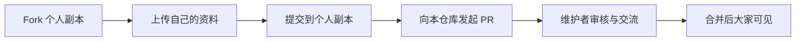

# 油专通关秘籍

把自己走过的学习路，变成后来同学更容易找到的路。

这里是由同学共同建设的课程资料共享社区。希望大家能找到需要的复习资料，也能留下自己的课堂笔记、解题思路、课程经验和勘误。无论来自哪个年级、哪个专业，都欢迎参与；一页笔记、一处纠错，也是一份有价值的贡献。

> 欢迎大家分享自己整理的课程资料：可以直接提交 Pull Request，也可以先开 Issue 讨论。期待一起营造良好的学习氛围，共同建设开放共享的开源环境。

[找课程资料](#courses) · [第一次上传资料](#first-upload) · [发起讨论或反馈](https://github.com/Seven-out-of-nine/upc-tongguan-miji/issues/new/choose) · [完整贡献指南](CONTRIBUTING.md)

## 🌱 我们希望一起建设什么

- **让资料更容易找到。** 按课程整理，注明适用范围与版本，让需要的人少一些翻找。
- **让理解能够传递。** 除了题目和答案，也欢迎分享推导、易错点、学习方法与复习路线。
- **让每个人都能参与。** 会用 Git 可以提交 PR；还不熟悉也可以按下面的网页教程上传，或先开 Issue 求助。

资料会随着大家的补充和纠错不断完善。欢迎友善讨论不同解法，尊重原作者的整理与付出，一起把这里建设成长期可用的学习社区。

<a id="courses"></a>

## 📚 课程导航

| 课程 | 目前收录的内容 | 资料入口 | 同学笔记 |
| --- | --- | --- | --- |
| 高等数学（2-1） | 复习路线、知识点、历年真题、答案导航与期末分析 | [进入高数资料](高数2-1/README.md) | [笔记分享](高数2-1/笔记分享/README.md) |
| 离散数学 | 课件、习题集、复习题、试卷与答案 | [进入离散数学资料](离散数学/README.md) | [笔记分享](离散数学/笔记分享/README.md) |
| 程序设计（C / C++） | 零基础学习路线、逐题讲解、知识点与示例源码 | [进入程序设计资料](程序设计/README.md) | [笔记分享](程序设计/笔记分享/README.md) |
| 军理 | 考试题库与复习提纲 | [进入军理资料](军理/README.md) | [笔记分享](军理/笔记分享/README.md) |
| 思政 | 资料较“狠”，仅向参与共创的同学提供；请联系仓库作者申请领取 | [查看领取说明](思政/README.md) | [笔记分享](思政/笔记分享/README.md) |

没有找到你的课程？欢迎新增课程目录，或[开一个 Issue](https://github.com/Seven-out-of-nine/upc-tongguan-miji/issues/new/choose)，一起把资料补起来。

<details>
<summary>展开查看：高数复习路线与常用入口</summary>

粗看课本知识点 → 复习 PPT → 重做练习册 → 做完近二十年真题（近五年精做，更早年份只想思路即可，数不用算）→ 课本练习题 → 高数学习指导。

| 入口 | 内容 |
| --- | --- |
| [复习首页与完整路线](高数2-1/README.md) | 六步复习安排与资料范围 |
| [知识点总览](高数2-1/复习资料/知识点总览.md) | 六个模块的知识框架与自测 |
| [概念简答与举例](高数2-1/复习资料/概念简答与举例.md) | 定义阐释、中值定理与分类讨论 |
| [真题与答案导航](高数2-1/复习资料/真题导航.md) | 逐学年题目、答案及年份缺口 |
| [期末试题分析报告](高数2-1/复习资料/期末试题分析报告.md) | 题型、分值、考点与解题方法 |
| [复习进度与错题模板](高数2-1/复习资料/复习进度与错题模板.md) | 精做、思路训练与错题复盘 |
| [资料清单](高数2-1/复习资料/资料清单.md) | 原始资料索引与使用说明 |

现有真题的年份缺口已在导航中标明。课程范围与复习重点请结合自己的课本、课堂 PPT 和教师要求使用。

</details>

---

## 🤝 你可以怎样参与

| 你想做的事 | 推荐方式 |
| --- | --- |
| 分享笔记、复习提纲、题解、课程经验，或补充一门新课 | 按下方教程上传，并提交 Pull Request（PR，合并请求） |
| 发现答案错误、文件失效或资料版本不明 | [开 Issue 反馈](https://github.com/Seven-out-of-nine/upc-tongguan-miji/issues/new/choose)，也欢迎直接提交修正 PR |
| 想分享资料，但不确定放哪里或不会操作 | [开 Issue 讨论／求助](https://github.com/Seven-out-of-nine/upc-tongguan-miji/issues/new/choose)，写清课程和资料情况 |
| 暂时没有资料可以分享 | 帮忙核对答案、补充来源、改进目录与教程，同样欢迎 |

普通贡献者通过自己的 **Fork（个人副本）** 提交修改，再用 PR 请求合并到本仓库，无需先成为仓库协作者。PR 由维护者审核合并后，资料才会出现在主仓库；Issue 用于交流，不会自动把附件加入课程目录。[^fork]

<a id="first-upload"></a>

## 🚀 第一次上传资料：只用浏览器即可

准备一个 GitHub 账号和想分享的文件，按下面六步操作。界面按钮可能显示英文，括号中标出了常见名称。



### 1. Fork 一份自己的副本

登录 GitHub，打开[本仓库](https://github.com/Seven-out-of-nine/upc-tongguan-miji)，点击右上角 **Fork → Create fork**。完成后，页面左上角的仓库拥有者应当是你自己的用户名。

### 2. 进入对应课程的上传目录

在自己的 Fork 中，分享笔记请进入对应课程的 **`笔记分享/`** 文件夹，例如 `离散数学/笔记分享/`；同学们提交的课堂笔记、知识总结、错题笔记和复习笔记统一放在这里，可按学年或章节继续建立子目录。课件、历年试题等其他资料仍按课程现有分类放置。

如果是新课程，先回到自己 Fork 的仓库根目录，用 **Add file → Create new file** 创建 `课程名称/README.md`，简单写上课程说明；再创建 `课程名称/笔记分享/README.md`，写上笔记收集说明。分享笔记时，进入新建的 `笔记分享/` 目录后再上传。

### 3. 上传文件并提交

在目标目录点击 **Add file → Upload files**，拖入文件或点击 **choose your files** 选择。填一条容易理解的说明，例如 `补充离散数学图论复习笔记`，再点击 **Commit changes** 保存到自己 Fork 的当前分支。上传前确认文件列表和路径正确。[^upload]

### 4. 发起 Pull Request

在自己的 Fork 页面点击 **Contribute → Open pull request**。也可以从[本仓库的 Pull requests 页面](https://github.com/Seven-out-of-nine/upc-tongguan-miji/pulls)点击 **New pull request → compare across forks**，核对：

| 项目 | 应当选择 |
| --- | --- |
| 目标仓库（base repository） | `Seven-out-of-nine/upc-tongguan-miji` |
| 目标分支（base） | `main` |
| 来源仓库（head repository／head fork） | 你自己的 Fork |
| 来源分支（compare） | 刚才上传资料的分支 |

确认修改列表只包含你想分享的文件，再填写 PR 的标题和说明。[^fork]

### 5. 说明你分享了什么

按 PR 模板写清课程、资料内容、适用学年／版本、来源或整理者，以及是否包含答案。信息暂时不全可以如实写“待补充”，不用为了填满模板猜测。填写后点击 **Create pull request**，完成向本仓库的提交。

### 6. 等待交流与合并

维护者可能会请你补充说明或调整目录。继续修改同一 Fork 的同一来源分支，原 PR 会随之更新；合并后可回到本仓库的课程目录查看你的贡献。[^pr]

只上传到自己的 Fork，还没有完成向本仓库的分享；请记得第 4 步提交 PR。操作卡住时，随时[开 Issue 求助](https://github.com/Seven-out-of-nine/upc-tongguan-miji/issues/new/choose)。

浏览器上传目前单文件上限为 25 MiB，每次最多 100 个文件；更大的资料、Git 命令操作和常见问题见[完整贡献指南](CONTRIBUTING.md)。[^upload]

## 🗂️ 让资料更容易被找到

- **笔记统一放进 `课程名称/笔记分享/`**，包括课堂笔记、知识总结、错题笔记与复习笔记；可以在其中按学年或章节分组。新增课程也应建立这个目录。
- 课件、习题、历年试题等其他资料，沿用对应课程现有分类。
- 文件名尽量写清学年、章节、题目／答案，例如 `2026-2027_图论_个人复习笔记.pdf`。
- 在课程 README 或 PR 中补一句内容、适用范围和来源；有答案、无答案、个人演算请分清。
- 分享自己整理、已获授权或允许公开分享的内容，保留原作者署名与授权说明，去除学号、联系方式等个人信息。
- 对不同理解友善讨论；发现问题欢迎指出具体页码、题号和修改理由，一起核对完善。

这里欢迎逐步完善的整理。暂时无法确认的内容标明“待核对”，比把不确定的答案写成定论更有帮助。

## 📥 下载与使用

进入课程目录后，可以在线阅读 Markdown、查看支持预览的文件，或下载原件。想下载整个仓库，在首页点击 **Code → Download ZIP**；会用 Git 的同学也可以克隆：

```bash
git clone https://github.com/Seven-out-of-nine/upc-tongguan-miji.git
```

具体资料的适用范围、版本和缺失部分，请查看对应课程说明。[贡献指南](CONTRIBUTING.md)介绍了如何补充、纠错和更新资料。

## 💬 从一次小小的分享开始

欢迎把你整理过、也希望别人少走弯路的内容留在这里。感谢每一位上传资料、认真核对、耐心答疑和改进仓库的同学。

希望这里既能帮助大家完成一门课的学习，也能让互相帮助、开放共享成为自然发生的事。

[^fork]: GitHub 官方：[从 Fork 创建 Pull Request](https://docs.github.com/en/pull-requests/how-tos/create-pull-requests/creating-a-pull-request-from-a-fork)。
[^upload]: GitHub 官方：[向仓库添加文件](https://docs.github.com/en/repositories/working-with-files/managing-files/adding-a-file-to-a-repository)。
[^pr]: GitHub 官方：[创建 Pull Request 与继续修改](https://docs.github.com/en/pull-requests/how-tos/create-pull-requests/creating-a-pull-request)。
