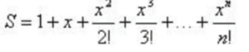

# 【函数】F7.05 求级数【★】

[学习首页](../README.md) · [本章目录](../chapters/ch03-function/README.md) · [知识点索引](../知识点索引.md)

来源：【测验】第3章 part2函数初步.html，第5题。

## 题目

【函数】F7.05 求级数【★】

【问题描述】

请编写一个计算级数和的函数fun，从键盘录入浮点数x和整数n，按给出的算式进行计算，其结果值S由函数值返回。



【输入】

x和n。

【输出】

级数的和s。

前置代码

```text
#include <stdio.h>
#include <bits/stdc++.h>
using namespace std;
```

后置代码

```text
int main()
{
    double x;
    int n;
    scanf("%lf%d",&x,&n);
    printf("%f\n",fun(x,n));
    return 0;
}
```

例如:

**输入：**

```text
0.3 10
```

**输出：**

```text
1.349859
```

### 题目与实现说明

- 公式来自已查看的本地原题图片。

## 解答

平台已给main，只提交下面函数，勿再提交main。完整程序供本地编译运行。

### 平台提交版

```c
double fun(double x, int n)
{
    double sum = 1.0, term = 1.0;
    for (int i = 1; i <= n; ++i) {
        term = term * x / i;
        sum += term;
    }
    return sum;
}
```

<details>
<summary>展开完整本地运行程序</summary>

```c
#include <stdio.h>

double fun(double x, int n)
{
    double sum = 1.0, term = 1.0;
    for (int i = 1; i <= n; ++i) {
        term = term * x / i;
        sum += term;
    }
    return sum;
}

int main()
{
    double x;
    int n;
    scanf("%lf%d",&x,&n);
    printf("%f\n",fun(x,n));
    return 0;
}
```

</details>

[下载完整源码](../solutions/ch03-function-05.c)

## 讲解

1. 已核对题图，要求计算1+x+x²/2!+…+xⁿ/n!，包含从0次到n次共n+1项。
2. sum和term都从1开始，分别代表当前总和与上一项。
3. 第i项等于上一项乘x再除以i，这样无需分别计算幂和阶乘。
4. 例如x=2,n=3，后续项是2、2、4/3，总和为6.333333；样例0.3,10得到1.349859。

## 知识点总结

- **由上一项递推下一项**：若相邻项有简单比例，可直接保存当前项term，而不分别计算幂和阶乘。本题第i项=上一项*x/i，所以term=term*x/i后再加入sum；n次循环得到0到n次的全部项，并避免阶乘先变得很大。

## 易错点

- 常数项1不能漏掉，n=0时结果也应为1。
- 用int阶乘作为分母会很快溢出；逐项递推避免了这一中间溢出。

## 相似题目

- [【函数】F7.04 求阶乘【★】](ch03-function-04.md)：共同练习：函数。
- [【函数】F7.09 公式求解【★】](ch03-function-09.md)：共同练习：级数、递推、函数。

## 再练一个用例

检查幂、阶乘和末项是否都计入。。

**输入：**

```text
2 3
```

**输出：**

```text
6.333333
```

---

[上一题：【函数】F7.04 求阶乘【★】](ch03-function-04.md) · [下一题：【函数】F7.06 浮点数四舍五入【★】](ch03-function-06.md)
