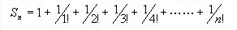

# 【函数】F7.09 公式求解【★】

[学习首页](../README.md) · [本章目录](../chapters/ch03-function/README.md) · [知识点索引](../知识点索引.md)

来源：【测验】第3章 part2函数初步.html，第9题。

## 题目

【函数】F7.09 公式求解【★】

【题目描述】

请编写函数GetSum，其功能是：从键盘录入一个整数n，并按下列多项式计算并输出其结果。



【输入】

一个整数n。

【输出】

多项式的和s。

预设代码

前置代码

```text
#include <stdio.h>
#include <bits/stdc++.h>
using namespace std;
```

后置代码

```text
int main()
{
   int  n;
   double  s;
   scanf("%d",&n);
   s=GetSum(n);
   printf("s=%f\n",s);
   return 0;
}
```

例如:

**输入：**

```text
15
```

**输出：**

```text
s=2.718282
```

### 题目与实现说明

- 公式来自已查看的本地原题图片。

## 解答

平台已给main，只提交下面函数，勿再提交main。完整程序供本地编译运行。

### 平台提交版

```c
double GetSum(int n)
{
    double sum = 1.0, term = 1.0;
    for (int i = 1; i <= n; ++i) {
        term /= i;
        sum += term;
    }
    return sum;
}
```

<details>
<summary>展开完整本地运行程序</summary>

```c
#include <stdio.h>

double GetSum(int n)
{
    double sum = 1.0, term = 1.0;
    for (int i = 1; i <= n; ++i) {
        term /= i;
        sum += term;
    }
    return sum;
}

int main()
{
   int  n;
   double  s;
   scanf("%d",&n);
   s=GetSum(n);
   printf("s=%f\n",s);
   return 0;
}
```

</details>

[下载完整源码](../solutions/ch03-function-09.c)

## 讲解

1. 已查看题图，要求Sₙ=1+1/1!+1/2!+…+1/n!。
2. sum初始为常数项1；term初始为1，表示上一项1/0!。
3. 每次令term/=i得到1/i!，再加入sum，因此不会先算出很大的阶乘。
4. 例如n=3时依次加入1、0.5、1/6，总和2.666667；n=15按六位小数输出2.718282。

## 知识点总结

- term/=i：等价于term=term/i；term为double，因此执行浮点除法。
- for循环上界<=n：恰好计入1/n!。
- double GetSum(int n)：参数是项数，返回值是含小数的和。

## 易错点

- 1和1/1!是两个不同的项，不能只加一次1。
- 若写1/factorial且两者都是int，除法会把多数项截成0。

## 相似题目

- [【函数】F7.04 求阶乘【★】](ch03-function-04.md)：共同练习：函数。
- [【函数】F7.05 求级数【★】](ch03-function-05.md)：共同练习：级数、递推、函数。

## 再练一个用例

确认包含常数项和第三阶乘项。。

**输入：**

```text
3
```

**输出：**

```text
s=2.666667
```

---

[上一题：【函数】F7.08 偶数分解【★】](ch03-function-08.md) · [下一题：【函数】F7.10 杀鸡用牛刀【★★★】](ch03-function-10.md)
