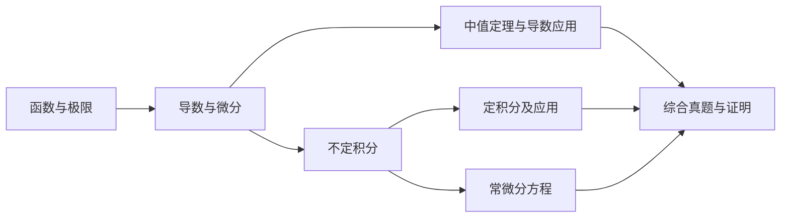

# 知识点总览与自测

[返回 README](../README.md)

复习主线按练习册前六章及本文件夹 2-1 真题组织。这里列的是知识结构与掌握标准，章节分值应看具体试卷，不能把某一年分配当成固定比例。

## 六个模块

| 模块 | 核心概念 | 需要会做的题 | 练习册答案的 PDF 页码 |
| --- | --- | --- | --- |
| [1. 函数与极限](知识点/01_函数与极限.md) | 定义域、数列与函数极限、无穷小、连续、间断点、闭区间连续性质 | 计算极限、无穷小比较、分类间断点、连续求参数、根的存在性 | 1—2 |
| [2. 导数与微分](知识点/02_导数与微分.md) | 导数定义、可导与连续、微分、链式法则、高阶导数 | 分段可导、隐函数与参数求导、反函数求导、切线法线、相关变化率 | 3—5 |
| [3. 中值定理与导数应用](知识点/03_中值定理与导数应用.md) | 罗尔／拉格朗日／柯西、洛必达、泰勒、单调与极值、凹凸 | 中值定理证明、不等式、零点个数、最值、渐近线、函数性态综合 | 6—7 |
| [4. 不定积分](知识点/04_不定积分.md) | 原函数、积分常数、换元、分部积分 | 基本积分、有理式、根式、三角积分、由原函数反求相关积分 | 8—10 |
| [5. 定积分及应用](知识点/05_定积分及应用.md) | 可积、牛顿—莱布尼茨、变限积分、反常积分 | 积分计算、积分与极限／导数综合、面积、旋转体、弧长、做功 | 11—12 |
| [6. 常微分方程](知识点/06_常微分方程.md) | 通解／特解、分离变量、一阶线性、二阶常系数线性 | 识别方程、求通解、代初值、检查解与适用区间 | 13—14 |

页码按 PDF 文件中的页面顺序计，不是纸质书页码。[练习册答案 PDF](../其他资料/高等数学2-1工科练习册答案参考.pdf)第15—19页、第20—24页分别为上册模拟（一）、（二），适合完成六模块后综合检查。

## 复习依赖

## 按题目反查

| 卡在哪一步 | 回看位置 |
| --- | --- |
| 看不出未定式；等价替换后得零；左右极限不同 | 模块1第3—5节，模块3第3—4节 |
| 分界点能否可导；微分和增量怎么比较 | 模块2第1、3节 |
| 参数二阶导、隐函数二阶导总出错 | 模块2第4—5节 |
| 不知道怎么构造辅助函数证明“存在一点” | 模块3第1—2节 |
| 渐近线、极值、拐点容易漏点 | 模块3第5—7节 |
| 换元还是分部；原函数信息怎么用 | 模块4 |
| 积分上限含函数；积分出现在极限中 | 模块5 |
| 面积、体积或做功不知道如何列式 | 模块5，先画图并定义微元 |
| 微分方程套错公式 | 模块6，先分类再计算 |
| 概念题会背不会解释或举例 | [概念简答与举例](概念简答与举例.md) |

## 每章完成标准

每个模块都过四关：**会说概念、会写条件、会独立解题、会解释错误**。答案对但条件遗漏、方法靠记忆而不能解释，都记为待复习。

- [ ] 函数与极限：能判断极限形式、分类间断点、证明根存在。
- [ ] 导数与微分：能处理分段点、隐函数、参数式、反函数与变化率。
- [ ] 中值与应用：能构造辅助函数，完整讨论单调、极值、凹凸和渐近线。
- [ ] 不定积分：会判断换元、分部、拆分，求完可用求导验算。
- [ ] 定积分：变限求导不漏链式，反常积分先判断收敛，应用题能列式。
- [ ] 微分方程：能识别类型，求通解并用初值确定常数。
- [ ] 概念表达：能为定义、定理条件与分类讨论给出自己的例子。

## 资料边界

本次总结以 2-1 的六个模块为主。[笔记 84.pdf](../其他资料/笔记%2084.pdf)的六页实际是**高数2-2期中重点整理**，涉及空间解析几何、多元微分与重积分等，不作为本次2-1复习主线。

练习册答案第25页以后还附有向量与空间解析几何、多元函数、重积分、向量值函数积分、级数、进一步的微分方程及下册模拟等内容，详见[资料清单](资料清单.md)。这些材料保留供后续使用，是否纳入本学期复习，应对照课堂大纲确认。
